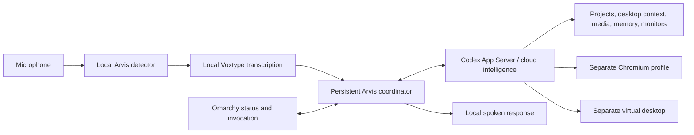

# Arvis desktop

Arvis is a persistent personal agent for Omarchy Linux. The desktop edition has a new runtime, independent of the older Raspberry Pi presence/sensor application in `../src`.

It combines a local **Arvis** wake word, local speech recognition and spoken replies, a cloud agent using your existing Codex/ChatGPT login, an independent browser, and a native Omarchy interface. You can keep using your desktop while it works in its own browser or virtual display.

## Use

| Action | How |
|---|---|
| Speak | Say **Arvis**, or press **Super+Alt+A**, then speak |
| Open conversation | Click Arvis in the bar, or **Super+Ctrl+Alt+A** |
| Stop current and queued work | **Super+Ctrl+Escape**, or `arvis-pc cancel` |
| Pause microphone | Right-click Arvis in the bar, or `arvis-pc mute` |
| Send a typed request | `arvis-pc ask "Investigate the preview issue in my Kits project"` |
| Check availability | `arvis-pc doctor --json` |
| Stop Arvis completely | `systemctl --user stop arvis` |
| Disable automatic startup | `systemctl --user disable --now arvis` |

The small native conversation view is optional. Voice requests run without opening it. Approval requests or questions appear there when a task needs your input. Stopping Arvis interrupts the agent, speech, and its independent workers. Process monitors remain active until their watched processes end or the service stops.

Examples:

- “What projects do I have in my Work folder?”
- “Open the local preview in your browser, reproduce this error, and investigate it.”
- “Look at my current window and explain the error.”
- “Remember that I prefer concise spoken updates.”
- “Watch process 12345 and let me know when it ends.”
- “Pause my music.”

## Architecture



The coordinator uses a private Unix socket, a serial conversation queue, persisted conversation IDs, and local history and preference files. Native and browser input targets are independent of your physical pointer. Their shared files/accounts still need coordination with your work; input isolation is not a security sandbox. The agent's shell runs under the Codex workspace sandbox and presents approval requests rather than bypassing it.

The browser supports semantic element references and screenshot-based coordinates, tab handling, downloads, and inspection. Native apps must be listed explicitly in `native_apps`, and run on a separate X display with their own application configuration and D-Bus session. Hardware-accelerated editors need separate compatibility testing; DaVinci Resolve support is not asserted.

## Install

Requirements: Omarchy/Hyprland, Python 3.12+, Chromium, Codex CLI authenticated with `codex login`, PipeWire, and Voxtype with a local Whisper model. This machine already has the base.en model.

```bash
cd desktop
python -m venv .venv
.venv/bin/python -m pip install -e '.[voice]' --find-links https://k2-fsa.github.io/icefall/piper_phonemize.html
.venv/bin/python scripts/setup_voice.py --with-tts
# Optional: signed distro binaries installed in user space, without sudo.
.venv/bin/python scripts/setup_native.py
.venv/bin/python scripts/install.py --start
```

The installer backs up changed user configuration, adds a user service and native bar widget, and checks for shortcut conflicts before adding keybindings. It does not alter packaged Omarchy files. Keep this checkout in place: the launcher uses its virtual environment.

## Configuration and data

- `~/.config/arvis/config.json`: workspace, project roots, voice and worker configuration.
- `~/.local/state/arvis/`: private socket, conversation ID, history, explicit preferences, worker profiles and previews.
- `~/.local/share/arvis/voice/`: local wake and speech models.
- `~/.local/share/arvis/workspace/`: default agent workspace.
- `~/.local/share/arvis/backups/`: copies of modified desktop configuration.

`ARVIS_CONFIG` and `ARVIS_STATE_DIR` can select isolated development settings. Stop the service before changing its state or clearing history. `arvis-pc new-conversation` starts a new conversation; explicitly remembered preferences remain until forgotten.

Idle microphone processing stays local. After activation, the transcribed request goes to the cloud agent. Requested screenshots, files, and tool results can also be sent to the agent. Voice recordings are temporary and deleted after transcription. Codex manages its own authentication; Arvis does not copy tokens or require a separate API key for its reasoning backend.

## Current boundaries

- Wake-word recognition pauses during thinking and speaking. Use the Stop shortcut to interrupt; simultaneous spoken interruption needs a later audio design.
- “Arvis” is configured exactly, but recognition quality depends on microphone placement and background noise. `energy_threshold`, `wake_threshold`, and `wake_score` are configurable. The shortcut remains available.
- Independent browser/app instances do not automatically inherit your usual logins or unsaved documents.
- Calendar and room-device connections are not configured. The earlier Pi controllers remain available for a later integration; desktop mode does not simulate successful room actions.
- Monitors can detect that an existing process ended, but cannot recover its exit code. They are not restored after a service restart.
- Arbitrary apps, professional editing workflows, and long unattended task reliability require further validation. A successful generic computer-use test is not proof of compatibility with every application.

## Development checks

```bash
PYTHONPATH=. .venv/bin/python -m unittest discover -s tests -v
# Explicit live check: local fixture plus real cloud agent (uses account quota).
PYTHONPATH=. .venv/bin/python tests/smoke_agent.py --run
# Local synthetic speech test; never plays audio or records the microphone.
PYTHONPATH=. .venv/bin/python tests/smoke_voice.py
```

Browser and native interaction tests need permission to create local sockets/processes. Tests use isolated profiles and synthetic pages/windows. They do not operate your ordinary browser or room devices.

Validated on this PC on 2026-10-26: 57 unit/integration tests across the coordinator, agent transport, browser, native worker, and voice code. The real cloud agent completed and independently verified both a browser form task (about 22 seconds) and a screenshot-driven native GUI task (about 62 seconds). Synthetic local speech activated **ARVIS**, rejected an unrelated sentence, and transcribed the intended command. The installed service also answered a conversation check. Live microphone accuracy and application-specific workflows still need real-use testing.
